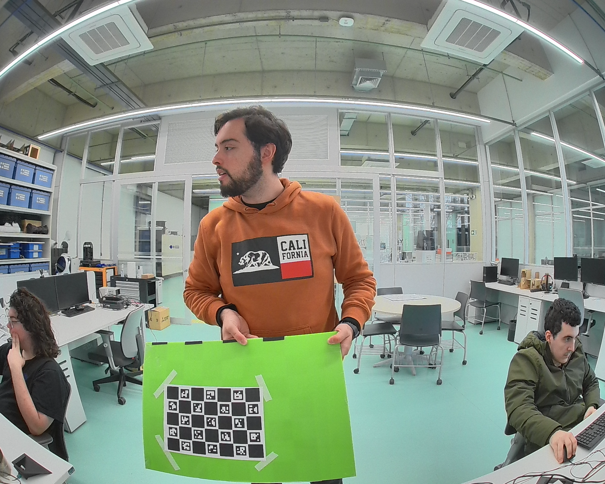
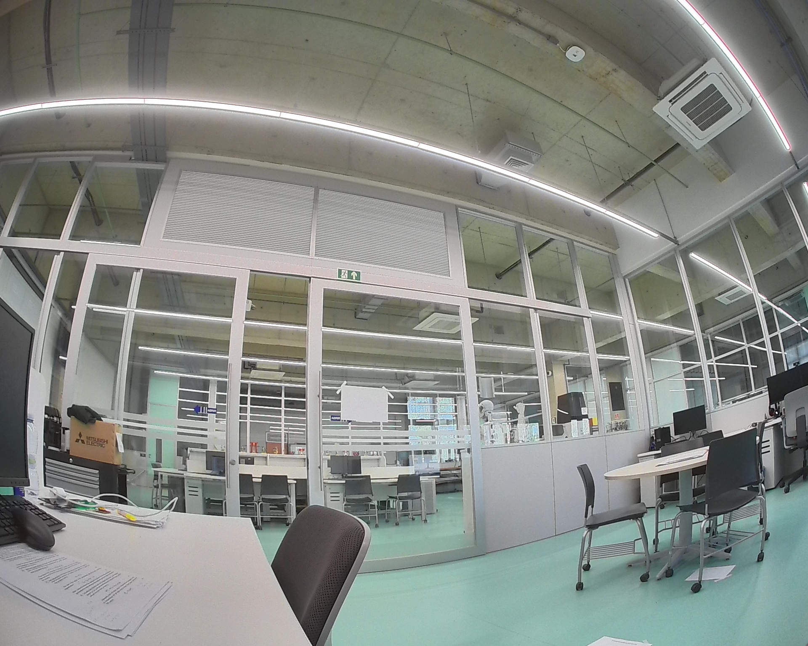
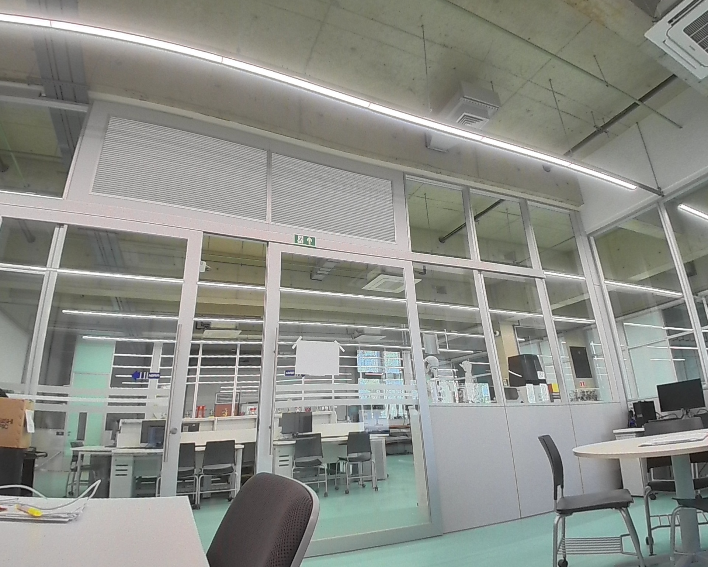

# Fisheye ChArUco Camera Calibration

<p align="center">
  <strong>Camera intrinsic calibration toolkit for fisheye and pinhole lenses using OpenCV and ChArUco boards.</strong>
</p>

<p align="center">
  Designed for practical robotics, automotive vision, multi-camera systems, 3D reconstruction and perception pipelines.
</p>

<p align="center">
  
</p>

<p align="center">
  <em>Real calibration frame captured with the fisheye camera used to validate this fork.</em>
</p>

---

## Overview

This repository provides a complete workflow for estimating camera intrinsic parameters using a **ChArUco calibration target**.

It supports both:

- **Fisheye camera calibration** using `cv2.fisheye.calibrate()`
- **Pinhole camera calibration** using OpenCV's conventional camera model

The repository also includes tools for:

- live ChArUco detection;
- capturing calibration images;
- estimating camera intrinsics;
- exporting parameters in COLMAP-compatible format;
- undistorting images;
- comparing fisheye and pinhole models;
- storing example datasets and expected outputs.

The project was adapted from the original  
[`jamiemilsom/Fisheye_ChArUco_Calibration`](https://github.com/jamiemilsom/Fisheye_ChArUco_Calibration)  
and extended for a cleaner, reproducible camera-calibration workflow.

---

# Features

✅ Live ChArUco board detection  
✅ Interactive image capture  
✅ Fisheye intrinsic calibration  
✅ Pinhole intrinsic calibration  
✅ RMS reprojection-error reporting  
✅ Image undistortion  
✅ COLMAP parameter export  
✅ OpenCV ArUco API compatibility  
✅ Clean dataset organization  
✅ Example calibration dataset included  
✅ Reproducible Python environment  

---

# Calibration Pipeline

```text
┌───────────────────────┐
│   Camera / Video Feed │
└───────────┬───────────┘
            │
            ▼
┌───────────────────────┐
│ ChArUco Board Detection│
└───────────┬───────────┘
            │
            ▼
┌───────────────────────┐
│ Calibration Images    │
│ data/calibration/...  │
└───────────┬───────────┘
            │
            ▼
┌──────────────────────────────┐
│ Camera Intrinsic Calibration │
│                              │
│   Fisheye       Pinhole      │
└───────────┬──────────────────┘
            │
            ▼
┌───────────────────────┐
│ Intrinsic Parameters  │
│ K + Distortion        │
└───────────┬───────────┘
            │
            ▼
┌───────────────────────┐
│ Image Undistortion    │
└───────────────────────┘
```

---

# Repository Structure

```text
Fisheye_ChArUco_Calibration/
│
├── data/
│   ├── calibration/
│   │   ├── images/
│   │   └── camera_intrinsics/
│   │
│   ├── raw_images/
│   └── undistorted_images/
│
├── examples/
│   ├── calibration_images/
│   ├── camera_intrinsics/
│   ├── raw_images/
│   └── undistorted_images/
│
├── docs/
│   └── README_images/
│
├── scripts/
│   ├── capture_calibration_images.py
│   ├── run_calibration.py
│   ├── undistort_images.py
│   └── generate_virtual_cameras.py
│
├── src/
│   ├── calibration/
│   │   └── calibrate.py
│   └── virtual_camera/
│
├── tests/
│
├── requirements.txt
├── setup.py
├── licence.txt
└── README.md
```

### `data/`

Working directory used for your own calibration.

Generated files in this directory are intentionally excluded from Git.

### `examples/`

Reference dataset included with the repository.

It contains:

- calibration images;
- resulting intrinsic parameters;
- raw camera images;
- corresponding undistorted images.

This provides a known working example for validating the installation and understanding the expected workflow.

---

# Requirements

Recommended environment:

```text
Python 3.10+
NumPy 1.26
OpenCV Contrib 4.8
```

The main Python dependencies are:

```text
numpy==1.26.0
opencv-contrib-python==4.8.0.76
```

`opencv-contrib-python` is required because the ChArUco and ArUco modules are part of OpenCV Contrib.

---

# Installation

Clone your fork:

```bash
git clone https://github.com/Jujupedro5052005/Fisheye_ChArUco_Calibration.git
cd Fisheye_ChArUco_Calibration
```

Create a virtual environment:

```bash
python3 -m venv .venv
source .venv/bin/activate
```

Upgrade pip:

```bash
python -m pip install --upgrade pip
```

Install the dependencies:

```bash
python -m pip install -r requirements.txt
```

Verify the installation:

```bash
python - <<'PY'
import cv2
import numpy as np

print("OpenCV:", cv2.__version__)
print("NumPy :", np.__version__)
print("ArUco :", hasattr(cv2, "aruco"))
print("Fisheye:", hasattr(cv2, "fisheye"))
PY
```

---

# ChArUco Board Configuration

The current repository is configured for:

| Parameter | Value |
|---|---:|
| Dictionary | `DICT_5X5_100` |
| Board size | `7 × 5` squares |
| Square length | `40 mm` |
| Marker length | `28 mm` |

Equivalent configuration:

```python
ARUCO_DICT = cv2.aruco.DICT_5X5_100

SQUARES_VERTICALLY = 7
SQUARES_HORIZONTALLY = 5

SQUARE_LENGTH = 0.040
MARKER_LENGTH = 0.028
```

> **Important**
>
> The dimensions and physical measurements configured in the software must match the printed board exactly.
>
> Do not print the board using any option that automatically rescales it to fit the page.

---

# 1. Capture Calibration Images

Connect the camera and run:

```bash
python scripts/capture_calibration_images.py
```

The default device is:

```text
/dev/video5
```

A different camera can be selected with:

```bash
python scripts/capture_calibration_images.py --device /dev/video0
```

### Keyboard Controls

| Key | Action |
|---|---|
| `SPACE` | Save valid calibration image |
| `S` | Save valid calibration image |
| `F` | Force-save raw image |
| `Q` | Quit |
| `ESC` | Quit |

Calibration images are stored in:

```text
data/calibration/images/
```

Forced raw frames are stored separately in:

```text
data/raw_images/
```

This prevents arbitrary test images from accidentally contaminating the calibration dataset.

---

# Capturing a Good Calibration Dataset

The quality of the calibration depends much more on **image diversity** than on simply collecting many images.

A good fisheye dataset should contain approximately:

```text
50–70 useful frames
```

Try to cover:

- image center;
- left and right edges;
- top and bottom edges;
- all four corners;
- close distances;
- medium distances;
- farther working distances;
- positive and negative yaw;
- positive and negative pitch;
- board roll;
- multiple board sizes in the image.

For fisheye lenses, observations close to the image boundaries are especially valuable because this is where lens distortion is strongest.

Avoid collecting many nearly identical frames.

A useful rough distribution is:

```text
40% near
40% medium
20% far
```

---

# 2. Run Camera Calibration

Once calibration images are available:

```bash
python scripts/run_calibration.py
```

The script calculates both:

```text
Fisheye calibration
Pinhole calibration
```

Results are stored under:

```text
data/calibration/camera_intrinsics/
```

The generated files are:

```text
fisheye_calibration.json
pinhole_calibration.json
```

Example output:

```text
============================================================
FISHEYE CALIBRATION
============================================================

Number of images used for calibration: 26
RMS reprojection error: 0.826293 px

K:
[[998.40712335   0.         965.57191672]
 [  0.        1001.22184062 774.67257586]
 [  0.           0.           1.        ]]

Distortion coefficients:
[[-0.05107059]
 [-0.01949934]
 [ 0.01741483]
 [-0.01020589]]
```

---

# Intrinsic Camera Matrix

The intrinsic matrix is defined as:

```text
     ┌ fx   0   cx ┐
K =  │ 0   fy   cy │
     └ 0    0    1 ┘
```

where:

- `fx` — focal length in pixels along X;
- `fy` — focal length in pixels along Y;
- `cx` — principal point X coordinate;
- `cy` — principal point Y coordinate.

For the fisheye model, OpenCV uses four distortion coefficients:

```text
D = [k1, k2, k3, k4]
```

---

# Fisheye vs Pinhole

The calibration script computes both models for comparison.

Example results from the included dataset:

| Model | RMS Reprojection Error |
|---|---:|
| Fisheye | `0.826 px` |
| Pinhole | `0.910 px` |

For strongly distorted wide-angle cameras, the fisheye model will generally provide the more appropriate representation.

For narrow-FOV cameras, the conventional pinhole model may be sufficient.

---

# 3. Undistort Images

Place test images inside:

```text
data/raw_images/
```

Then run:

```bash
python scripts/undistort_images.py
```

The default model is:

```python
MODEL = "fisheye"
```

Undistorted images are saved in:

```text
data/undistorted_images/
```

---

# Fisheye Balance Parameter

The fisheye undistortion script exposes:

```python
BALANCE = 0.6
```

This controls the trade-off between preserving the original field of view and removing unused image regions.

Conceptually:

```text
BALANCE = 0.0
│
├── more cropping
├── less black border
└── smaller retained FOV


BALANCE = 1.0
│
├── larger retained FOV
├── more image boundary visible
└── potentially larger black regions
```

A value around:

```text
0.5 – 0.7
```

is often a useful starting point.

---

# Example Data

The repository includes a complete example under:

```text
examples/
```

### Calibration images

```text
examples/calibration_images/
```

Contains a known ChArUco calibration dataset.

### Reference intrinsics

```text
examples/camera_intrinsics/
```

Contains the resulting fisheye and pinhole calibration files.

### Raw images

```text
examples/raw_images/
```

Contains distorted images from the camera.

### Undistorted images

```text
examples/undistorted_images/
```

Contains the corresponding corrected images.

These files can be used as a visual reference when validating a new installation.

---

# Visual Examples

## ChArUco Target

<p align="center">
  
</p>

<p align="center">
  <em>Reference ChArUco target used by the original project.</em>
</p>

## Real Calibration Capture

<p align="center">
  
</p>

<p align="center">
  <em>Example from the calibration dataset included with this fork. The board is detected across a wide portion of the fisheye field of view.</em>
</p>

## Real Camera Image — Before Undistortion

<p align="center">
  
</p>

<p align="center">
  <em>Raw image captured from the fisheye camera.</em>
</p>

## Same Image — After Fisheye Undistortion

<p align="center">
  
</p>

<p align="center">
  <em>Result produced using the calibrated fisheye model and the repository's undistortion pipeline.</em>
</p>

## Original Detection Reference

<p align="center">
  
</p>

<p align="center">
  <em>Original repository reference image illustrating ChArUco corner detection.</em>
</p>

---

# Complete Workflow

The normal workflow is:

```bash
# 1. Activate environment
source .venv/bin/activate

# 2. Capture calibration images
python scripts/capture_calibration_images.py --device /dev/video0

# 3. Estimate camera intrinsics
python scripts/run_calibration.py

# 4. Capture or place arbitrary images in data/raw_images/

# 5. Undistort the images
python scripts/undistort_images.py
```

In short:

```text
Camera
  │
  ▼
Capture ChArUco Images
  │
  ▼
Intrinsic Calibration
  │
  ├── Fisheye K + D
  │
  └── Pinhole K + D
  │
  ▼
Capture Raw Images
  │
  ▼
Undistortion
  │
  ▼
Ready for downstream computer vision
```

---

# COLMAP Export

The calibration script also prints the camera parameters in a COLMAP-compatible format.

For example:

```text
OPENCV_FISHEYE:
fx, fy, cx, cy, k1, k2, k3, k4
```

This makes the calibration directly useful in reconstruction and multi-view vision pipelines.

---

# Applications

This calibration pipeline is suitable for:

- autonomous vehicles;
- robotics;
- surround-view camera systems;
- visual perception;
- camera–LiDAR fusion;
- bird's-eye-view systems;
- visual odometry;
- SLAM;
- 3D reconstruction;
- COLMAP workflows;
- multi-camera systems;
- industrial computer vision.

---

# Troubleshooting

### Camera cannot be opened

Check available camera devices:

```bash
ls /dev/video*
```

Then specify one explicitly:

```bash
python scripts/capture_calibration_images.py --device /dev/video0
```

---

### ChArUco board is not detected

Check:

- the correct ArUco dictionary is being used;
- the printed board geometry matches the software configuration;
- the board is sufficiently large in the image;
- illumination is adequate;
- motion blur is low;
- the complete board is not required, but enough identifiable markers must be visible.

---

### Calibration dataset is empty

Calibration images must be located in:

```text
data/calibration/images/
```

---

### Undistortion finds no images

Raw images must be located in:

```text
data/raw_images/
```

---

### Wrong Python/OpenCV version is loaded

Verify:

```bash
which python
python -c "import sys; print(sys.executable)"
```

Then inspect OpenCV:

```bash
python - <<'PY'
import cv2
print(cv2.__version__)
print(cv2.__file__)
PY
```

The path should point inside the active virtual environment.

---

# Calibration Quality

RMS reprojection error is useful, but it should **not be the only validation metric**.

A good calibration should also be visually inspected.

Pay particular attention to:

- straight lines near image edges;
- poles and building edges;
- horizon geometry;
- consistency across the entire image;
- excessive stretching near the borders.

For robotics and sensor-fusion applications, downstream projection accuracy is ultimately more important than minimizing RMS alone.

---

# Notes for Fisheye Calibration

Fisheye calibration is especially sensitive to dataset coverage.

A dataset containing only centered views can produce a low numerical error while still providing poor correction near the image boundaries.

For this reason, intentionally move the board toward:

```text
┌──────────────────────────────────┐
│ X             X              X   │
│                                  │
│                                  │
│ X            CENTER          X   │
│                                  │
│                                  │
│ X             X              X   │
└──────────────────────────────────┘
```

and vary its orientation significantly.

---

# Development

The calibration implementation is located in:

```text
src/calibration/calibrate.py
```

Client-facing utilities are located in:

```text
scripts/
```

The scripts add the repository's `src/` directory automatically, so the normal workflow does not require an editable package installation.

---

# Contributing

Contributions and improvements are welcome.

When modifying calibration behavior, validate changes against the included example dataset to ensure that intrinsic estimates remain consistent.

Recommended checks include:

```bash
python scripts/run_calibration.py
python scripts/undistort_images.py
```

and visual comparison against:

```text
examples/
```

---

# Attribution

This repository is based on:

**Fisheye ChArUco Calibration**  
by Jamie Milsom

Original repository:

```text
https://github.com/jamiemilsom/Fisheye_ChArUco_Calibration
```

This fork reorganizes and extends the project with a simplified workflow, updated OpenCV compatibility, calibration examples, capture utilities, reproducible dependencies and improved documentation.

---

# License

See:

```text
licence.txt
```

for the licensing terms inherited from the original project.

---

<p align="center">
  <strong>Accurate calibration is the foundation of reliable perception.</strong>
</p>
